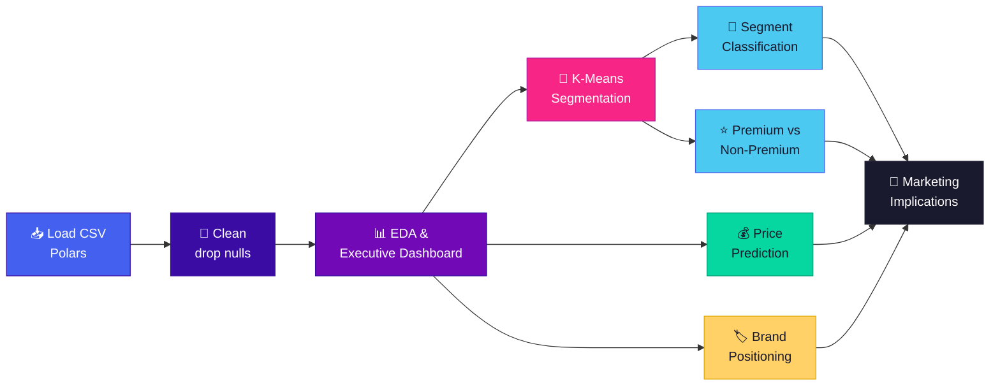

<div align="center">

# 🚗 Driving Decisions with Data
### Marketing Analytics for the Used-Car Market

*Pricing optimization · Market segmentation · Brand positioning — across ~100K real listings*

**Quarto · Python · Polars · scikit-learn · Plotly**

98,837 listings · 10 variables · 9 brands · 4 segments · ~98% premium-classifier accuracy

</div>

---

## 📌 Table of Contents

- [🎯 The Big Questions](#-the-big-questions)
- [📦 The Dataset](#-the-dataset)
- [🛠️ Tech Stack](#️-tech-stack)
- [🔄 Analytics Workflow](#-analytics-workflow)
- [📊 What's Inside the Report](#-whats-inside-the-report)
- [💡 Key Findings](#-key-findings)
- [📣 Marketing Playbook](#-marketing-playbook)
- [🚀 Getting Started](#-getting-started)
- [📁 Project Structure](#-project-structure)
- [🧭 Roadmap & Known Gaps](#-roadmap--known-gaps)
- [🙏 Acknowledgements](#-acknowledgements)

---

## 🎯 The Big Questions

Used-car buyers weigh mileage, brand, engine size, fuel efficiency, and a dozen other attributes before they commit. Dealerships, in turn, have to decide what to stock, how to price it, and who to sell it to. This project turns a large marketplace dataset into answers for three marketing questions:

| | Question | Approach |
|:-:|---|---|
| 💰 | **Pricing Optimization** — Which features most influence used-car prices? | EDA, Linear Regression, Random Forest, SVR |
| 🧩 | **Market Segmentation** — What vehicle/customer segments exist, and how should dealers target them? | K-Means clustering, PCA, multinomial Logistic Regression |
| 🏷️ | **Brand Positioning** — Where does each brand sit in the market, and where are the openings? | OLS-based Brand Premium Score, perceptual positioning maps |

---

## 📦 The Dataset

The data comes from a **Kaggle collection of used-car listings** aggregated from multiple online marketplaces.

<table>
<tr>
<td valign="top" width="50%">

**🔤 Categorical**
- `Brand`
- `model`
- `transmission`
- `fuelType`

</td>
<td valign="top" width="50%">

**🔢 Numeric**
- `year`
- `price`
- `mileage`
- `tax`
- `mpg`
- `engineSize`

</td>
</tr>
</table>

**At a glance**

| Metric | Value |
|---|---|
| 📋 Observations | 98,837 |
| 💵 Average price | $16,797 |
| 🛣️ Average mileage | 23,094 miles |
| ⛽ Most common fuel type | Petrol |
| ⚙️ Transmission mix | 57% manual / 43% automatic |
| 🏭 Brands covered | Audi · BMW · Mercedes · VW · Ford · Skoda · Toyota · Hyundai · Vauxhall |

> 📝 The report expects the data file to be named **`Final_dataset.csv`** and to sit in the same folder as the `.qmd`. Rows with nulls are dropped on load.

---

## 🛠️ Tech Stack

| Layer | Tools |
|---|---|
| 📄 Reporting | **Quarto** (`.qmd` → self-contained HTML) |
| 🧹 Data wrangling | **Polars** (primary), pandas (for model interop) |
| 🤖 Machine learning | **scikit-learn** — `Pipeline`, `ColumnTransformer`, `StandardScaler`, `OneHotEncoder`, `KMeans`, `PCA`, `LogisticRegression`, `LinearRegression`, `RandomForestRegressor`, `SVR` |
| 📐 Statistics | **statsmodels** (OLS for the Brand Premium Score) |
| 🎨 Visualization | **Plotly** (Express + Graph Objects), matplotlib, seaborn |

The dashboard visuals use a custom palette carried throughout the report: `#4361EE`, `#3A0CA3`, `#7209B7`, `#F72585`, `#4CC9F0`, `#06D6A0` and `#FFD166`.

---

## 🔄 Analytics Workflow



---

## 📊 What's Inside the Report

<details open>
<summary><b>1️⃣ Exploratory Data Analysis</b></summary>
<br>

- **🚘 Used Car Market Dashboard** — a 3×3 Plotly layout with six KPI indicators (total vehicles, average and median price, average mileage, MPG, brand count, average vehicle age) plus a top-brands bar chart and fuel-type and transmission donuts.
- **🔥 Price Matrix: Transmission × Fuel Type** — a heatmap of average price across every combination.
- **📈 Price Distribution** — histogram with mean and median markers, filtered to listings ≤ $50,000 for readability.

</details>

<details>
<summary><b>2️⃣ Market Segmentation (K-Means)</b></summary>
<br>

- Features: `year`, `price`, `mileage`, `tax`, `mpg`, `engineSize`, standardized inside a scikit-learn `Pipeline`.
- **Elbow plot** to choose *k* → **k = 4**.
- Segment profiles (mean price, mileage, engine size, count).
- **PCA 2-D projection** of the clusters.
- **Cluster comparison dashboard** — box plots of price, mileage and engine size by segment.

</details>

<details>
<summary><b>3️⃣ Targeting & Classification</b></summary>
<br>

- **Multinomial Logistic Regression** predicts a car's segment from its attributes (70/30 stratified split); averaged absolute coefficients show which features define segments.
- **Binary model — Premium vs Non-Premium**: Logistic Regression flags Cluster 3 (premium) listings, with a confusion-matrix heatmap and coefficient chart.

</details>

<details>
<summary><b>4️⃣ Price Prediction (Continuous Outcome)</b></summary>
<br>

- Target: `price`. Features: `Brand`, `transmission`, `fuelType` (one-hot) + `year`, `mileage`, `tax`, `mpg`, `engineSize` (scaled).
- Three pipelines sharing one `ColumnTransformer`: **Linear Regression**, **Random Forest** (120 trees), and **SVR**.
- Compared on **RMSE**, with actual-vs-predicted scatter plots.

</details>

<details>
<summary><b>5️⃣ Brand Positioning</b></summary>
<br>

- Brand summary table (avg price, mileage, engine size, MPG, listing count).
- Average price by brand and market share by listing count.
- **⭐ Brand Premium Score** — fits an OLS model of expected price, then averages *actual − expected* per brand. Built twice: once on engine size, mileage and year, and once as a holistic model using more features.
- Perceptual maps: **Price vs Mileage** and **Price vs Engine Size**.

</details>

---

## 💡 Key Findings

### 💰 Pricing

- 🔋 **Hybrids command the highest prices** under both transmissions, and automatic hybrids sit well above manual ones.
- ⚙️ **Automatics carry a premium over manuals** for every fuel type.
- ⛽ **Manual petrol cars are the most affordable segment**, the natural entry point for first-time buyers.
- 📉 Prices are **right-skewed**: the mean sits above the median, most inventory falls in the **$10K–$25K** band, and listings above **$35K** form a smaller premium tail.

### 🧩 The Four Segments

| Segment | Profile | Avg Price | Avg Mileage | Avg Engine |
|:-:|---|--:|--:|--:|
| **1 · Mid-Range** | Balanced affordability and performance | ~$14,765 | ~15,146 | ~1.42 L |
| **2 · High-Mileage Budget** | Older, heavily used, lowest prices | ~$11,232 | ~57,132 | ~1.96 L |
| **3 · Premium** | Newer, low-mileage, high-performance | ~$32,028 | ~9,039 | ~2.31 L |
| **4 · Economy Compact** | Affordable, moderate mileage | ~$11,198 | ~35,594 | ~1.52 L |

**What separates segments?** Year matters most, followed by mileage and price. Tax and engine size play supporting roles, and MPG barely moves the needle.

### ⭐ Premium Prediction

The premium-vs-non-premium logistic regression reaches **~98% accuracy** with very few misclassifications. Higher price and bigger engines push a car toward "premium," newer and lower-mileage cars are more likely to qualify, and high MPG pulls the other way, which separates eco-minded buyers from luxury buyers.

### 🤖 Price Models

Random Forest tracks actual prices far more closely than Linear Regression. The linear model's predictions scatter widely, a sign that price relationships in this market are **non-linear**. (Exact RMSE values print when the report is rendered.)

### 🏷️ Brand Positioning

```
Premium Score (actual − expected price)

  Audi      ████████████  ▲ strong brand equity
  Mercedes  ███████████   ▲
  VW        ███           ▲ moderate
  BMW       ██            ▲
  Ford      ▏▌            ▼ mild discount
  Skoda     ▏▌            ▼
  Toyota    ▏████         ▼ sells below expected
  Hyundai   ▏████         ▼
  Vauxhall  ▏███████      ▼ deepest discount
```
<sub>Illustrative ordering based on the report's narrative; bar lengths are not to scale.</sub>

The positioning maps show a clean **luxury vs mass-market split**: BMW, Mercedes and Audi cluster at high price and larger engines; VW sits in the middle; Ford, Toyota, Hyundai, Skoda and Vauxhall occupy the affordable, smaller-engine space. Skoda shows a value–perception gap relative to its pricing.

---

## 📣 Marketing Playbook

| 🎯 Goal | ✅ Recommended Move |
|---|---|
| Maximize margin | Prioritize **automatic hybrids and diesels** in inventory |
| Win first-time buyers | Run budget campaigns around **manual petrol** cars under $15K |
| Hit the volume sweet spot | Concentrate stock and spend in the **$10K–$25K** range |
| Expand reach above the median | Push **financing offers** on higher-priced vehicles |
| Serve Segment 3 (Premium) | Upsell warranties, detailing, accessories and performance packages |
| Serve Segment 2 (High-Mileage) | Lead with maintenance plans, repairs and wear-part replacement |
| Serve Segments 1 & 4 | Value bundles, service reminders, loyalty programs |
| Defend premium brands | Audi and Mercedes should keep premium pricing and lean on brand equity |
| Fix negative premiums | Toyota, Hyundai and especially Vauxhall should push reliability messaging, upgrades or repositioning |

---

## 🚀 Getting Started

### Prerequisites

- 🔵 [Quarto](https://quarto.org/docs/get-started/) installed
- 🐍 Python 3.9+ with Jupyter

### 1. Clone and set up

```bash
git clone <your-repo-url>
cd <your-repo-folder>

python -m venv .venv
source .venv/bin/activate        # Windows: .venv\Scripts\activate

pip install polars pandas numpy scikit-learn statsmodels \
            plotly matplotlib seaborn joblib jupyter nbformat pyarrow
```

### 2. Add the data

Download the used-car listings dataset from Kaggle and save it in the project root as:

```
Final_dataset.csv
```

### 3. Render the report

```bash
quarto render Final_Project.qmd
```

This produces a **single self-contained HTML file** with all interactive Plotly charts embedded, so you can open it in any browser or share it as one file. 🎉

> 💡 To iterate quickly, use `quarto preview Final_Project.qmd` for live reload.

---

## 📁 Project Structure

```
📂 used-car-marketing-analytics/
├── 📄 Final_Project.qmd      # Full analysis: code + narrative
├── 📊 Final_dataset.csv      # Kaggle used-car listings (add locally)
├── 🌐 Final_Project.html     # Rendered report (generated)
└── 📘 README.md              # You are here
```

> 🔤 The uploaded file is currently named `Final_Project__1___1___1___1_.qmd`. Renaming it to `Final_Project.qmd` keeps commands and links tidy.

---

## 🧭 Roadmap & Known Gaps

The analysis is complete, but a few report sections are still scaffolds. Worth finishing before publishing:

- [ ] ✍️ **Executive Summary** — currently a heading only
- [ ] 📋 **Results and Findings**, **Managerial Recommendations**, **Actionable Plans** — placeholder lists (`1. 2. 3.`)
- [ ] 🏁 **Conclusion** and 📚 **Works Cited** — empty; cite the Kaggle dataset here
- [ ] 🔢 Report the **SVR** results alongside Linear Regression and Random Forest, and add the RMSE numbers to the narrative
- [ ] 🔁 The final **Price Distribution Analysis** chunk near the end is empty and duplicates an earlier section
- [ ] 🚲 The model interpretation text refers to **"bike price"**; should read **car price**
- [ ] 📦 Replace the in-chunk `!pip install statsmodels` with a `requirements.txt`
- [ ] 🧹 Remove the unused `create_kmeans_pipeline` helper (the report uses `create_pipeline`)
- [ ] 🏷️ Update the YAML `title: "Sample Project"` to a real project title

---

## 🙏 Acknowledgements

- 📚 Built for **MKTG – Lee** (Marketing Analytics)
- 🗂️ Data: used-car listings collection on **Kaggle**
- 🛠️ Powered by the open-source Python data ecosystem: Polars, scikit-learn, statsmodels, Plotly, matplotlib and seaborn

<div align="center">

<br>

**⭐ If this project helped you think about pricing, segmentation or positioning, give it a star!**

<sub>Made with 🐍 Python · 📊 Plotly · 💙 Quarto</sub>

</div>
